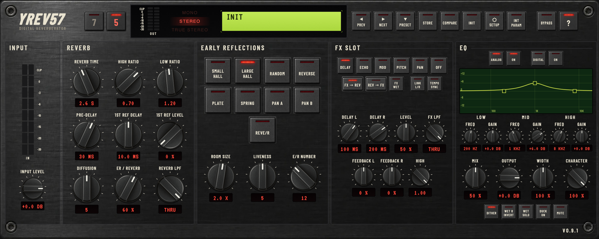

# YREV57


[](https://opensource.org/license/agpl-v3)
[](https://somsubhra.github.io/github-release-stats/?username=tehguitarist&repository=YREV57&page=1&per_page=30)



**A free, open-source digital reverb.** YREV57 is inspired by two mid-1980s Yamaha digital reverbs, the REV7 (1985) and the
REV5 (1987). Both were 16-bit machines with a mono-summed wet path, and much of their character came from the converters
and filters around the reverb as well as the reverb itself. YREV57 models that converter chain and runs our own
delay and all-pass reverb engine inside it. An **era switch** (7 or 5) is the main character control. It runs as AU, VST3, LV2 (Linux)
and Standalone.

> YREV57 is an independent product, inspired by the Yamaha REV7 and REV5. It is not affiliated with, endorsed by or
> sponsored by Yamaha Corporation. Yamaha, REV7 and REV5 are trademarks of Yamaha Corporation, used here only to describe
> the hardware that inspired this plug-in.

**Status: beta, version 0.9.1.** See [Status](#status).

## Highlights

- **Two eras.** Era 7 is modelled on the REV7: 31.25 kHz native rate, 12 kHz bandwidth, no dither, decays of 0.3 to 10 s.
  Era 5 is modelled on the REV5: 44.1 kHz, 20 kHz bandwidth, dithered A/D, decays of 0.3 to 99 s, a secondary reverb,
  up to 34 early reflections, early-reflection feedback and a digital EQ. Switching era crossfades the whole engine.
- **Converter model.** The engine runs at the era's native rate inside a model of the converters: band limit, emphasis
  pair, 16-bit truncation, hiss and (era 5) dither. A **CHARACTER** knob runs from clean to the full model.
- **Reverb and early reflections.** Reverb time, high and low ratios, pre-delay, 1st reflections, diffusion, density,
  space modulation and a secondary reverb, with early-reflection patterns (small hall, large hall, random, reverse, plate,
  spring, the reverb programs' own early reflections (REV E/R), and in era 5 pan A and B) and a
  balance between reflections and reverb.
- **FX slot.** Delay, echo, modulation (flange, reverb flange, chorus A and B, phasing, tremolo, symphonic), pitch shift
  and auto-pan (the last two era 5 only), before or after the reverb. A gate is included.
- **Two EQs.** A wet-only analogue 3-band EQ in both eras, and a digital 3-band parametric EQ in era 5.
- **Modern additions.** True-stereo wet input, wet stereo width, an input-keyed ducker, wet solo, an output safety limiter,
  a resizable panel, host automation of every panel control, and presets.
- **Light on CPU.** About 1.3 to 1.8 % of one Apple M1 Pro core at 48 or 96 kHz.
- **Presets.** 15 generic presets of our own, plus the 30 REV7 and 39 REV5 programs under the names and settings printed
  in the owners' manuals, and your own user presets.

## Features

- Wet input mode: **Mono** (left input only), **Stereo** (L+R summed, as the hardware) or **True stereo** (plugin only: the
  early reflections lean to the side the input comes from).
- Analogue EQ: low, mid and high, frequency and gain, on the wet path only.
- Digital EQ (era 5): three bands with Q, and peak or shelf on the low and high bands.
- Internal parameters drawer (the **INT PARAM** key): density, space modulation, reverb low-pass, secondary reverb,
  left and right 1st reflections, early-reflection feedback, gate and ducker settings.
- Preset browser with FACTORY, USER, COMBI, REV7 and REV5 banks; store, rename, delete, import, export, compare and init.
- Per-era settings memory, so each era keeps its own settings (or share them across eras).
- Reports the reverb tail to the host. No latency is reported: the converter's delay is taken off the pre-delay.
- Tooltips on every control (the **?** key switches them off).

The full control reference is in the **[user manual](docs/manual.md)**.

## Install

Download the installer for your system from the [Releases page](https://github.com/tehguitarist/YREV57/releases):

| System | Installer | Formats |
|---|---|---|
| macOS | `.pkg` | AU, VST3 |
| Windows | `.exe` | VST3 |
| Linux | `.deb` | VST3, LV2 |

On a Mac there are two installers: the standard one for Apple Silicon, and a **Universal** one for Intel Macs and for
DAWs that run under Rosetta. If your DAW does not find YREV57 or reports it cannot be loaded, try the Universal installer.

Then rescan plugins in your DAW. Logic caches Audio Units, so if YREV57 does not show up, restart Logic or run
`auval -v aufx Yr57 Yrev`. You can also build from source (below).

## Using it

Pick an **era** (7 or 5) with the two keys at the top left, then choose a preset from the **PRESET** list or set the
controls by hand. The panel is one screen: the input meter and knob on the left, the reverb and early-reflection controls,
the FX slot, the EQ, and mix, output, width and character at the right. Drag a knob to change it, double-click it to
reset it, or click a value readout to type a number. Hover over any control for a description.

A new instance starts on INIT: mix 50 %, input and output at 0 dB, width 100 %, character 100 %. The
panel is resizable, and the Setup key opens the settings (quality, wet input default, noise seed, era settings, output
safety limiter, UI scale).

> **Tip:** shift-click the era key that isn't lit. There's a secret preset hiding behind it.

The user manual in the repository (docs/manual.md) describes each control.

## How it works

The signal path, from the design notes in [docs/design/architecture.md](docs/design/architecture.md):

1. The stereo input splits. The dry signal stays stereo. The wet path is summed to mono (or, optionally, true stereo).
2. A wet-only 3-band analogue EQ, then the converter model: anti-alias filter, pre-emphasis, conversion to the era's
   native rate, 16-bit quantiser, plus dither in era 5.
3. The reverb engine at the native rate: early reflections from a multitap read, a diffuser, and a late network of
   damped delay loops with modulation and an optional secondary reverb. The FX slot sits before or after it.
4. The digital EQ (era 5), then the converter's output: conversion back to the host rate, de-emphasis, reconstruction filter.
5. Width, ducker, mix, bypass and output level.

The late network is our own design; it does not use any firmware or ROM data. The
decisions behind this are recorded as ADRs in [docs/design/decisions/](docs/design/decisions/): running at the native rate
([0001](docs/design/decisions/0001-native-rate-engine.md)), the mono wet sum
([0002](docs/design/decisions/0002-mono-wet-sum.md)), our own late network
([0003](docs/design/decisions/0003-own-late-network.md)), "inspired by" rather than a clone
([0004](docs/design/decisions/0004-inspired-by.md)), JUCE ([0005](docs/design/decisions/0005-juce-framework.md)) and the
true-stereo wet input ([0006](docs/design/decisions/0006-true-stereo-wet-input.md)). The engine's tuning is described in
[docs/design/engine.md](docs/design/engine.md).

## Build

You need CMake 3.25 or newer and a C++20 compiler (Xcode on macOS, Visual Studio on Windows, GCC or Clang on Linux).
JUCE 9.0.5 is fetched by CMake on first configure.

```bash
git clone https://github.com/tehguitarist/YREV57.git
cd YREV57
cmake -S . -B build -DCMAKE_BUILD_TYPE=Release
cmake --build build --config Release -j 8
```

The targets are `YREV57_Standalone`, `YREV57_VST3`, `YREV57_LV2` (Linux only) and `YREV57_AU` (AU on macOS only). The plugins land under
`build/YREV57_artefacts/Release/`.

- `-DYREV_COPY_AFTER_BUILD=ON` installs the plugins into your user plugin folders (off by default).
- `-DCMAKE_OSX_ARCHITECTURES=arm64` builds for Apple silicon only, which is faster than the default universal build.
- Set `FETCHCONTENT_BASE_DIR` to a shared folder to reuse one JUCE checkout across build directories.
- Tests: configure with `-DYREV_BUILD_TESTS=ON`, build the `YREV57Tests` target, then run
  `ctest --test-dir build --output-on-failure`.

The CI and release workflows run by hand only; see [docs/release.md](docs/release.md). Contributor rules are in
[CONTRIBUTING.md](CONTRIBUTING.md) and the project guidance for Claude Code is in [CLAUDE.md](CLAUDE.md).

## Status

**Beta.** Every feature is in: the panel, every parameter, the preset banks and the whole DSP chain. It builds as AU,
VST3 and Standalone, passes Apple's `auval` and pluginval at strictness 10 (AU and VST3) and its automated tests, and costs about 1.3 to 1.8 % of one Apple M1 Pro core (block 256, 48 or 96 kHz; about 2.2 % at 192 kHz).

Before 1.0:

- **The listening pass.** The voicing has not been finalised by ear yet and may still change, including four
  period-style FX options that are off until they are judged.
- **Inspired by, not a copy.** YREV57 is our own interpretation of the sound of these units, built from publicly
  available documentation and listening. It does not reproduce their circuits or firmware.
- **Some hardware features are not modelled.** The four instrument early-reflection modes (piano, organ, brass, guitar) are
  hidden until there is data for them, and MIDI features (program change, triggers) are dropped in favour of DAW
  automation.
- **Beta builds.** Installers are signed and notarised on macOS; the Windows and Linux builds are unsigned, so Windows may show a SmartScreen warning.

The [roadmap](ROADMAP.md) has what is left before 1.0. Design notes are in [docs/](docs/README.md).

## Repository layout

```
src/plugin/        Processor, parameters, presets, editor (src/plugin/ui: skin and generated layout)
src/dsp/           Chain, converter, engine, FX slot, EQ, ducker, width
tests/             Catch2 tests
assets/            UI skin images and OFL fonts (compiled into the plugin)
installer/         macOS .pkg, Windows NSIS, Linux .deb scripts
.github/           CI and release workflows
data/              CSVs: ER taps, presets, parameter ranges, ICs, components, patents
tools/             Python generators (ER tables, presets, UI layout) and the ER chart digitiser
docs/              manual, design notes, ADRs
```

## Licence

YREV57 is free software under the [GNU AGPLv3](LICENSE). It uses [JUCE](https://juce.com) under its AGPLv3 option, and
the notices for it and the other third-party code are in [THIRD_PARTY_NOTICES.md](THIRD_PARTY_NOTICES.md).

## Legal

YREV57 is an independent product, inspired by the Yamaha REV7 and REV5. It is not affiliated with, endorsed by or sponsored by Yamaha Corporation. Yamaha, REV7 and REV5 are trademarks of Yamaha Corporation, used here only to describe the hardware that inspired this plug-in. SPX and REV1 are likewise trademarks of Yamaha Corporation, named only descriptively in the design notes and code comments. No firmware, ROM dump or SysEx data from the units is used; the REV7 and REV5 presets use only settings printed in the owners' manuals. Third-party manuals are kept locally and are not distributed. See [docs/legal.md](docs/legal.md).

## Credits

Built by Leigh Pierce, using [JUCE](https://juce.com/) for the plugin framework and interface.
