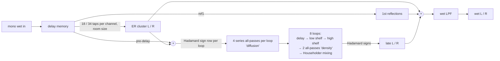
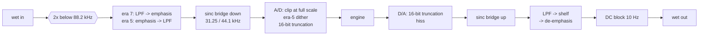

# Reverb engine

> Code: [`src/dsp/Engine.h`](../../src/dsp/Engine.h), [`Engine.cpp`](../../src/dsp/Engine.cpp); tests: [`tests/EngineTests.cpp`](../../tests/EngineTests.cpp). Everything here is our own design (ADR 0003) unless a manual or patent is cited. The engine runs at the era's native rate inside the converter model (below). The voicing was tuned by ear and against reference recordings of the factory programs; it is an interpretation, not a model of any Yamaha unit's firmware.

## Structure

1. **Delay memory and reflections.** One delay line holds the pre-delay, the reflection taps and the 1st-reflection taps, as in US 4,803,731 (one memory read at many taps, a room-size coefficient scaling all of them). Tap tables come from each unit's published E/R charts at room size 4.0: era 7 the REV7's (18 per channel), era 5 the REV5's (34 per channel), in [`data/er-taps/`](../../data/er-taps/), generated into `src/dsp/ErTables.h` by [`tools/gen_er_tables.py`](../../tools/gen_er_tables.py). Tap times are taken relative to the charts' first tap, scaled by `room_size / 4` (inference) and offset by the pre-delay. Each channel's cluster is energy-normalised, so `er_count` and the mode change the pattern, not the level. Taps carry a sign. The reverb programs play short early-tap sets of their own, read from reference recordings of the factory programs and offset (not scaled) by the initial delay: REV7 three or more per channel per program, REV5 one set per Rev mode (Hall, Room, Plate, Percussion Plate, Spring, Echo Room, Strings, Snare, the combinations). Era 7 reads each tap as a two-sample average, with a per-program offset (hidden `voice_tap_read`). In era 5 the reflections pass a short all-pass set by `diffusion` (both units' E/R programs have a DIFFUSION control). The E/R2 programs (hidden `er_type`) play their first taps dry beside a parallel decaying tail voiced per chart mode; the REV5 hall E/R2 tail runs through damped all-passes (a one-pole low-pass in each feedback path), and the Plate E/R2 tails recirculate at a length that follows room size and liveness. Era 5 also has a PIANO E/R mode beside REV E/R (a pattern scaled by room size, beside a short parallel tail).
2. **Liveness** ("the rate at which the reflected sounds fade", REV5 OM p. 21, REV7 OM p. 14): 5 plays the chart as drawn; below 5 later taps fade faster; above 5 the chart's own fade flattens towards equal levels. The reflection energy stays the same at every liveness (ours).
3. **Late network.** The late network hears mostly the two reflection clusters and a little of the pre-delayed input, so its energy arrives over the reflection span as a room's does (ours). That feeds four series all-passes (gain set by `diffusion`, each kept short enough that its own tail dies well before the reverb's), then eight loops of 45–88 ms whose feedback is mixed each sample by Householder reflections. Each loop has a low shelf, a high shelf and two all-passes whose gain follows `density`. A one-pole low-pass at the era's input bandwidth sits before the diffuser (inference that the hardware band-limited its reverb input), and the reflections take their own one-pole.
4. **Decay law.** Loop gain `g = 10^(-3 L / (fs · RT))` on the effective loop length `L` (the delay plus each all-pass's contribution to the time its energy is held). The shelves set the loss at low and high frequencies by Jot's rule from `rt × lo_ratio` and `rt × hi_ratio`. The printed HIGH is read as the decay ratio at the top of each unit's band: about 10 kHz in era 7, 16 kHz in era 5 (with a 12 kHz corner); deep treble cuts are capped per pass so 1 kHz holds `rt`. A third shelf below 120 Hz sets the sub-bass decay against the bass decay (per program: hidden `voice_sub_hz` / `voice_sub_ratio`). Loops run in double precision so the tiny shelf gains at long RT stay exact. The secondary reverb uses the same law.
5. **Stereo.** L and R read the same eight loops with two orthogonal Hadamard sign rows, so the late tail is uncorrelated from one network (ADR 0002). The bass and lower mids are tilted mildly towards the middle by complementary all-pass splits and a band-pass cross-feed (ours).
   **Time variance (era 7; ADR 0007):** the late read-out gains drift slowly (half the energy, about 3 s, L and R independent, above 120 Hz), so two passes of the same sound decorrelate in the tail as the REV7's do while the spectrum stays put. Era 5 stays static.
   **Per-program voice:** hidden, per-preset parameters (`voice_*`, [parameters.md](parameters.md)) set each program's diffuser size and gain, crossovers, reflection gain and tilts, late onset and the shelves above, so one network can follow each factory program. Two optional early stages serve programs whose early field is a smooth haze rather than discrete taps: an early fill (four short all-passes per channel) and an early cloud (velvet noise, one tap per 1 ms cell); *CLA Drum Room* uses both.
6. **Level.** The loop input is scaled by `sqrt((1 − g²) / (1 − g_ref²))` with a 2 s reference, so long decays do not swell. `er_rev_balance`: 100 % = reflections only, 50 % = both at full level, 0 % = late only (the REV5's ER/REV BAL, OM p. 18).
7. **Wet LPF.** First-order low-pass at `wet_lpf` kHz, off at 17 (thru).
8. **Space modulation** (`space_mod` 0–10, default 0 as on the REV5 factory programs; the manual gives the control but no rate or depth). Each loop's delay read swings sinusoidally by up to ±0.8 ms at 10, at its own rate (0.43–1.29 Hz) and fixed starting phase. The fractional read is a first-order all-pass interpolator, so `rt` and the ratios hold. At 0 the read is the exact integer one.
9. **Switching.** The reflection taps, pre-delay, 1st reflections and reflection level form one read layout. When it changes, the old and new layouts are read together and crossfaded with equal-power gains over 30 ms; a change during a fade waits for it to end. Loop filters change at once (their poles stay inside the unit circle).
   **Whole-engine crossfade** ([`Chain`](../../src/dsp/Chain.cpp)): an era change, an eco change, a preset load or compare, or a state restore swaps the whole converter. The chain holds two converter slots; the idle slot is reset with the new settings, the inputs crossfade over 30 ms, and the old slot rings out with its own settings until it falls below −100 dBFS (or fades after 30 s). Preset loads are read under a sequence lock, so the engine never runs half a preset.
10. **ER feedback** (era 5; REV5 OM p. 21): a comb on each channel's reflection output, so the whole pattern repeats FB DLY (0.1–1,400 ms) later, at FB GAIN (±99 %), with FB HIGH as a one-pole low-pass in the loop ([`LoopHighCut.h`](../../src/dsp/LoopHighCut.h)). The 1st reflections are not repeated.
11. **Secondary reverb** (era 5; p. 17): four loops of 40–70 ms with one all-pass each, fed from the primary network's input after REV2 DLY (0–500 ms), decaying at rt × REV2 TIME with the same ratios, at REV2 LVL relative to the primary (ours).
12. **Gate** (era 5; pp. 18, 36; [`Gate.h`](../../src/dsp/Gate.h)): after the engine and FX, keyed by the A/D input. Trigger level 1–100 % maps linearly in dB across the input range; opens after the trigger delay with a 1 ms ramp, holds, then falls exponentially over the release. The programs that print GATE LVL can gate the program input instead (hidden `gate_input`).

The engine sits in [`Chain`](../../src/dsp/Chain.cpp) between the analogue EQ and the digital EQ. The processor clamps `rt`, `room_size` and `er_count` to the era's limits, and `getTailLengthSeconds` follows `pre_delay + reflection span + rt × max(1, lo_ratio)`.

## Converter model

[`src/dsp/Converter.*`](../../src/dsp/Converter.cpp) wraps the engine; the filter coefficients are in [`ConverterFilters.h`](../../src/dsp/ConverterFilters.h).

- **Linear part:** one low-pass stage used twice (anti-alias in, reconstruction out, as on the schematics) plus a first-order shelf. Era 7: an elliptic low-pass near 12 kHz; era 5: an elliptic low-pass near 21 kHz; both fitted to the units' measured single-path response, magnitude and group delay, with no bass lift and no hold droop. Turned into biquads per host rate by a prewarped bilinear transform, at twice the host rate below 88.2 kHz.
- **Emphasis pair, from the schematic:** a first-order shelf (zero 3,092 Hz, pole 10,281 Hz) and its exact inverse; REV7 order LPF → emphasis, REV5 emphasis → LPF.
- **Non-linear part, from the schematic and specs:** converter full scale at +6 dBFS host (design choice); hard clip at the A/D; magnitude truncation to 16 bits; TPDF dither in era 5 when `dither` is on; hiss at about −90 dB re full scale; era 7's D/A has a small differential linearity error at bipolar zero, set so low-level THD matches the PCM53 datasheet's typical figures. Both eras pass a 10 Hz high-pass (DC block).
- **No phantom hiss:** hiss and dither follow the signal through slow gates, so an idle plugin is silent.
- **`character`:** 0 % = 24-bit, no hiss, no dither; 100 % = 16-bit with hiss and dither. Band limit and emphasis stay: they are the era.
- **Settings (state properties, not parameters):** *Quality* Eco runs everything at the host rate (no rate bridge, no 2× stages), keeping the band limit, emphasis, 16-bit words, hiss and dither. *Noise seed* Random or Frozen (renders repeat sample for sample). *Output safety limiter* (on by default): instant gain reduction to −0.1 dBFS with 150 ms recovery. *Era settings*: **Per era** (default) keeps one set of settings for each era; **Shared** carries them across.
- **Timing:** the bridge delay (about 2–3 ms, fixed per host rate) is reported to the host as latency and the dry is delayed to match, so pre-delay, 1st reflections and FX delays play as printed (ADR 0001).
- **Tests** ([`ConverterTests.cpp`](../../tests/ConverterTests.cpp)): response points at 44.1 / 48 / 96 kHz, latency compensation, truncation, hiss levels, clipping, no aliasing of a 20 kHz tone, decay to silence, block-size invariance, era switching, the DC block.

## CPU

Benchmark: the hidden test `YREV57Tests "[.bench]"` ([`tests/BenchTests.cpp`](../../tests/BenchTests.cpp); 20 s of noise bursts and silences through the whole processor; median of 5 runs; one M1 Pro core). Typical cost is 1.3–2.4 % of one core at 48 or 96 kHz, block 256.

Optimisations, none of which change the output by more than −170 dB: half-band stages that skip zero taps; per-phase rate-bridge kernels built in `prepare`; the FX slot skipped while off; bridge rings converted to double once; delay lines staggered across cache sets so their writes do not evict one another.
